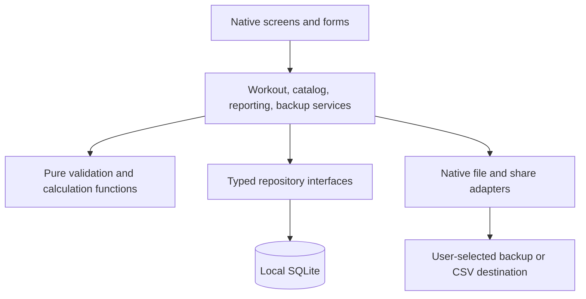

# Architecture and decision record

Status: proposed native implementation based on the agreed offline-first scope. Date: October 31, 2026. The repository currently contains the HTML preview only.

## Decision: one native client with local relational storage

Use React Native, Expo, and strict TypeScript. Use Expo Router for navigation and `expo-sqlite` for the source of truth. Use `expo-file-system`, `expo-sharing`, and `expo-document-picker` for portability; bundle Recursive and Solar assets locally. Select the stable Expo SDK compatible with the installed Expo Go on the test devices at scaffold time; install native packages with `npx expo install` and commit exact resolved versions in the lockfile. No versions are pinned by this document.

Why: iOS/Android need a shared mobile UI, quick offline set entry, relational workout history, and portable files. Separate native projects duplicate work. A web wrapper prioritizes the existing prototype over native input/navigation needs. Cloud-first storage adds accounts and sync conflict handling before either is wanted. A backend, REST/GraphQL service, authentication, and remote telemetry are unnecessary for v1.

Trade-offs: uninstallation/device loss can lose local data without a user-held backup; manual file transfer replaces automatic sync. Expo Go is a development preview, not a distribution mechanism. If SDK/device compatibility requires it, use an Expo development build; signed standalone/store builds are a later milestone. Revisit this decision if cross-device sync becomes a requirement; UUIDs help identity but do not implement conflict resolution.

## Modules and dependency direction

| Module | Owns | Depends on |
|---|---|---|
| storage | Connection, versioned migrations, transactions, repository implementations | SQLite adapter |
| catalog | Locations, session types, exercises, equipment, routines | storage |
| workouts | Draft lifecycle, ordered saves, completion, snapshots, historical edits | catalog, storage |
| reporting | Matching-equipment references, calendar, summaries, streaks, progress | workout read models, goal history |
| portability | Backup/restore contracts, CSV, document picker/sharing | storage transactions, domain validation, file adapters |
| presentation | Native routes, Coral Daylight components, keyboard and screen-reader behavior | public module services |

Domain calculations have no React, Expo, SQL, or filesystem imports. UI components never execute SQL. Repositories return domain records, not driver result objects. Keep forms local; a small React context owns the active-session ID, settings, repository services, and a committed-data revision counter. Refresh dependent queries after committed mutations. Do not add a global state library or query cache until it solves a demonstrated problem.

Proposed layout: `src/app/` for routes, `src/features/` for the catalog/workout/reporting/portability screens and services, `src/domain/` for pure rules and record types, `src/storage/` for SQL/migrations/repositories, `src/ui/` for tokens and shared controls. Colocate focused tests; keep database integration tests and platform journey scripts in `tests/`.

## Navigation and presentation

Tabs: Home, Routines, History, Exercises. Home owns weekly progress, calendar, and links into summaries; History provides sessions, exercise progress, and Week/Month/Year summaries. Workout setup and active logging are stack screens; day details and settings/data tools are sheets or stack detail screens. Opening details retains the caller's date/period/scroll position. Settings is accessible from the Home header. Preserve the prototype's visual direction while using React Native controls and safe-area/keyboard handling rather than copying browser markup.

Implement semantic light/dark tokens, 500/700 font weights, tabular numerals, 20px cards, coral fill, peach selection surfaces, and contrasting text as recorded in [design-notes.md](design-notes.md). Standard actions target at least 48 logical pixels; compact calendar cells may be narrower but maintain visible spacing and accessible date labels. Support text scaling, reduced motion, screen readers, visible selection indicators, and confirmation of destructive actions. Never encode completion only through color.

## Persistence and lifecycle

Open one database, enable foreign keys and WAL, and run ordered migrations tracked by `PRAGMA user_version` before rendering dependent screens. A migration failure shows a recovery screen; never delete/reset a personal database automatically. Use parameter binding for user data. Keep raw `execAsync` for fixed trusted migration/PRAGMA SQL. Serialize writes through one service queue and use `withExclusiveTransactionAsync` for multi-row changes; every statement in a transaction uses its provided transaction handle.

Valid complete input edits enqueue a save immediately. Intermediate strings such as an empty weight or trailing decimal stay in form state until valid. Flush pending valid edits on blur/background and await all pending writes before Finish, export, or navigation that requires persistence. Never promise a save before commit. Surface failures with retry; preserve unsaved values in memory. Abrupt process death may lose an unfinished keystroke, but cannot mark an uncommitted set saved. Restore the single persisted unfinished session at launch.

Routine selection copies slots and resolved equipment references into a draft. On completion, retain completed set/exercise snapshots and mark the session completed in one transaction; remove incomplete set rows and empty exercise rows from the completed session. Repeated Finish with the same session ID returns the existing completed session rather than inserting another. Drafts never enter reports. Session edits are atomic and invalidate all derived views. Archive catalog entries instead of deleting referenced records. Routine changes never propagate into session snapshots.

Store session recorded duration separately from timestamps. For normal sessions, suggest elapsed start-to-finish time, clearly editable for interruptions or an overnight draft; quick entries can leave it unknown. This is recorded session time, not a physiological measure or a background-running timer requirement.

## Internal service contracts

Use UUID strings for IDs; do not use names as keys. Inputs are validated at service/file boundaries and enforced with SQL constraints where applicable. Read failures, valid empty results, and loading are separate UI states. Mutation failures use a typed error code: `VALIDATION`, `NOT_FOUND`, `DRAFT_EXISTS`, `STORAGE`, `UNSUPPORTED_BACKUP`, `INVALID_BACKUP`, or `RESTORE_CHANGED`; include a safe user-facing message without dumping workout data into logs.

| Service operation | Required contract |
|---|---|
| `startSession({locationId, routineId?, sessionTypeId})` | Return an active session ID; resolve explicit location variations or unresolved-slot choices; never auto-select another gym's machine |
| `saveSet({sessionId, sessionExerciseId, setId, values, completed})` | Idempotent update by set ID; serialize operations; enforce measurement-mode rules |
| `finishSession({sessionId, activityDate, recordedDurationSeconds, quickConfirmation?})` | Flush saves, validate completed content or explicit quick entry, atomically complete; repeated call is safe |
| `getPreviousSets({equipmentVariationId, beforeSessionId})` | Latest completed matching variation, excluding the edited/current session; return recorded units and date |
| `getPeriodSummary({kind, anchorDate})` | Shared local-date bounds; return activeDays, sessions, knownDurationSeconds, missingDurationCount, type/location/group counts and period status |
| `getWeeklyStreaks({asOfDate})` | Effective goals plus unique completed dates; current/longest streak and achieved weeks |
| `createBackup()` / `exportCsv({fromDate?, toDate?})` | Consistent read snapshot after queued writes; return a generated local file, then offer sharing separately |
| `inspectBackup(file)` / `restoreBackup({inspectionToken, confirmedReplace:true})` | Validate immutable cached file, show counts, verify file digest/database revision unchanged, then replace in one transaction |

## Verification and operational limits

Use `jest-expo` with React Native Testing Library for forms and domain behavior; actual SQLite integration tests run on the selected Expo runtime/device so mocks cannot establish transaction safety. Verify native file sharing/picking on both platforms. Keep the existing Node/Chrome preview check for design reference only; it does not verify native persistence or accessibility.

No remote monitoring by default. Surface database/write/import failures locally and keep any diagnostic logs free of exercise notes, export contents, or personal history. Backups are plain files protected by the destination chosen by the user, not app-level encrypted archives. OS sandbox protections are the v1 storage boundary; do not add unsupported custom encryption. Share-sheet success means handing a file to the OS, not proof it reached cloud storage.

## Official references checked

- [Expo Router introduction](https://docs.expo.dev/router/introduction/): native routing foundation.
- [Expo SQLite](https://docs.expo.dev/versions/latest/sdk/sqlite/): persistent local database, parameterized writes, migration example, exclusive transactions, foreign keys and WAL.
- [Expo FileSystem](https://docs.expo.dev/versions/latest/sdk/filesystem/): current `File`/`Paths` API for local files; avoid deprecated top-level legacy methods.
- [Expo Sharing](https://docs.expo.dev/versions/latest/sdk/sharing/): sharing local file URIs through the native action sheet.
- [Expo DocumentPicker](https://docs.expo.dev/versions/latest/sdk/document-picker/): user-selected import files and cache copying before reading.
- [Expo unit testing](https://docs.expo.dev/develop/unit-testing/): `jest-expo` and React Native Testing Library; native SDK mocks are not proof of real SQLite behavior.

Checked October 31, 2026. Recheck the chosen SDK's matching versioned references when implementing, rather than assuming `/latest/` remains unchanged.
